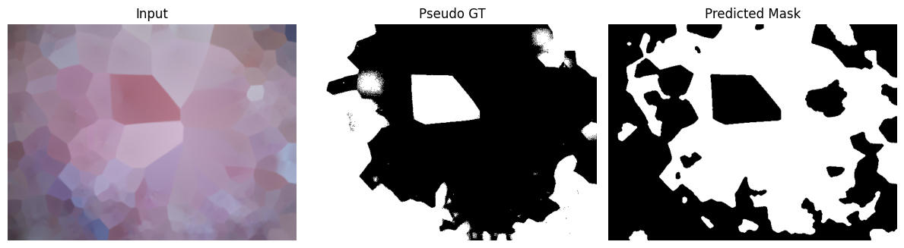

# Skin Cancer Lesion Segmentation and Classification

## Project overview

The workflow is organized into these stages:

1. Obtain the HAM10000 dataset and load its metadata.
2. Create a stratified train/validation/test split before augmentation.
3. Apply Dull-Razor preprocessing to reduce hair artifacts.
4. Apply augmentation to training images only.
5. Train an EfficientNet-B3-based, seven-class classifier with class-weighted cross-entropy.
6. Evaluate the held-out test set and generate a confusion matrix and training curves.
7. Demonstrate lesion segmentation using a deterministic morphological/Otsu pipeline and calculate Dice/Jaccard metrics on a demonstration subset.
8. Demonstrate a lightweight Mayfly-inspired search over selected hyperparameters.

## Dataset

The notebook is configured for **HAM10000**. Download it from Kaggle:

- Dataset: https://www.kaggle.com/datasets/kmader/skin-cancer-mnist-ham10000
- Kaggle API instructions: https://www.kaggle.com/docs/api

The seven label codes used by the notebook are:

| Code | Common label |
|---|---|
| AKIEC | Actinic keratoses / intraepithelial carcinoma |
| BCC | Basal cell carcinoma |
| BKL | Benign keratosis-like lesions |
| DF | Dermatofibroma |
| MEL | Melanoma |
| NV | Melanocytic nevi |
| VASC | Vascular lesions |

Check the dataset's accompanying documentation for the exact label definitions and limitations.

## Reported test results

The accompanying results report records the following values for its held-out test set:

- Test images: 1,503
- Overall classification accuracy: 61.94%
- Macro-average F1-score: 0.4276
- Mean Dice coefficient for the segmentation demonstration: 0.0410 ± 0.0379
- Mean Jaccard index for the segmentation demonstration: 0.0213 ± 0.0201

These are the values in the supplied report, not a guarantee that a fresh run will reproduce them. The low reported segmentation scores indicate that the demonstration segmentation pipeline needs substantial improvement before being used to support segmentation claims.

## Segmentation Results (Dice & Jaccard)

**Mean Dice Coefficient:** 0.0410 ± 0.0379

**Mean Jaccard Index:** 0.0213 ± 0.0201

### Segmentation Visualization

## Important implementation notes

- The classification model defined in the notebook is based on **EfficientNet-B3**; it is not a full Mask R-CNN implementation.
- The Mayfly-inspired hyperparameter search is a **lightweight demonstration**, not a full-scale optimizer evaluation.
- The segmentation section uses a morphological/Otsu demonstration pipeline. The notebook/report does not establish that a fully trained Fuzzy U-Net was evaluated on a comprehensive set of ground-truth lesion masks.
- HAM10000 does not provide official segmentation masks for every image. A rigorous segmentation study requires suitable image-mask pairs and clearly defined evaluation procedures.
- Split counts and reported metrics should be checked against the outputs from the exact notebook run before using them in a paper.

## Suggested future improvements

- Evaluate segmentation on a dataset with expert-annotated lesion masks.
- Compare against clearly specified segmentation and classification baselines.
- Report per-class precision, recall, F1-score, and confusion matrix.
- Fix random seeds and record package versions, dataset version, and split identifiers.
- Validate that every metric is computed from the stated held-out split.
- Perform external validation before making clinical-performance claims.

## Disclaimer

This project is for educational and research purposes only. It is not intended to replace professional medical advice, diagnosis, or treatment.
